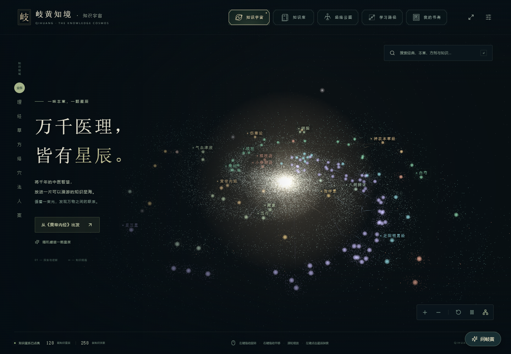
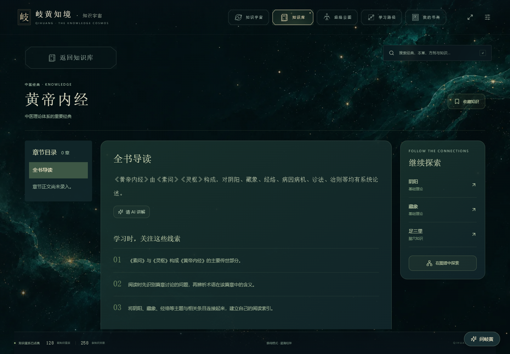
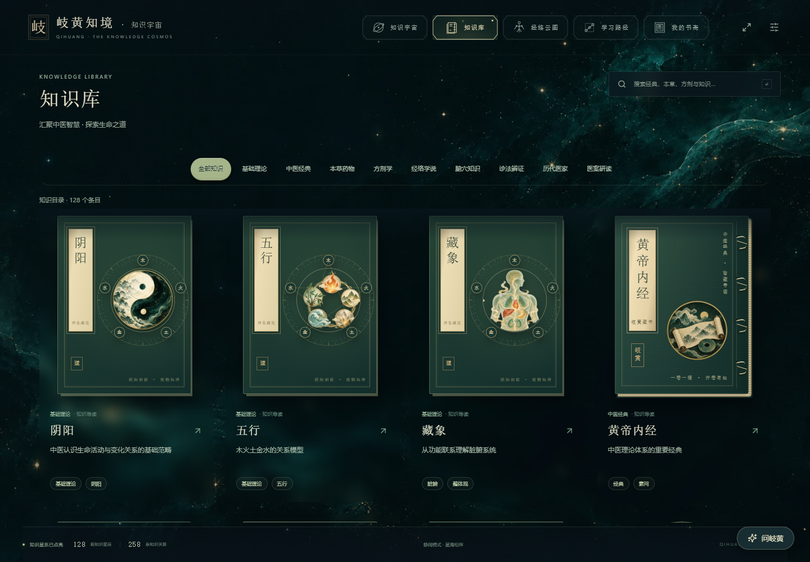
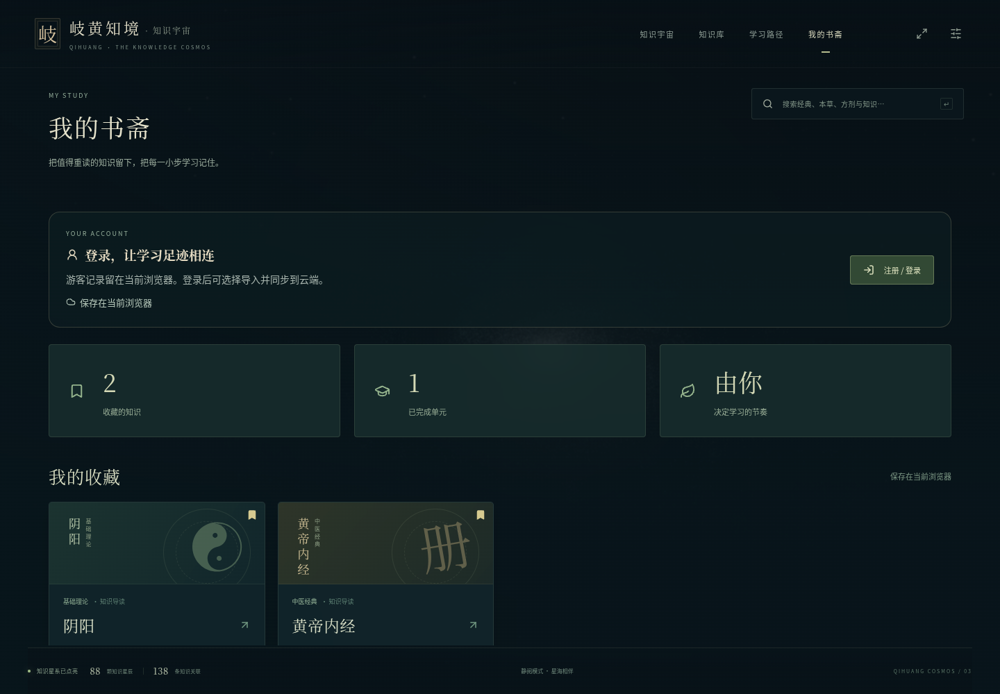

# 岐黄知境 · 知识宇宙

> 一味本草，一颗星辰。万千医理，皆有星辰。

岐黄知境是一个面向中医学习者与爱好者的知识探索网站。它将经典、理论、本草、方剂、经络与医家放进一片可以漫游的知识星海，让你从一个感兴趣的问题出发，沿着知识之间的联系，逐步建立自己的理解。

**[进入岐黄知境 →](https://qihuang-zhijing.onrender.com)**

*知识宇宙首页：在星海中搜索、筛选与探索，让经典、理论、本草和方剂彼此相连。*

## 在星海中，发现知识的联系

中医知识常常相互贯通：一部典籍连接一种理论，一首方剂连接几味本草，一个腧穴连接一条经脉。

在岐黄知境，每个知识条目都是一颗星辰。你可以按住鼠标左键拖动来旋转视角，按住右键拖动来平移视角，滚动滚轮来缩放视野；左键点击星辰，即可阅读导读，也可以沿着关联光束，继续探索相关知识。从《黄帝内经》出发，认识阴阳、藏象与经络；从桂枝汤出发，了解方剂、本草与经典之间的联系。

## 你可以在这里做什么

### 漫游知识宇宙

在三维星海中探索不同知识领域，通过分类筛选、关键词搜索或随机邂逅，找到下一颗想了解的知识星辰。

*点击《黄帝内经》，阅读知识导读，再沿着关联星辰探索阴阳、藏象与足三里。*

### 查阅中医知识库

知识库涵盖中医经典、基础理论、本草药物、方剂学、经络、腧穴、诊法辨证、历代医家与医案等领域。每个条目提供简介、来源说明与关联知识，方便查找和延伸阅读。

*按知识领域筛选，或搜索感兴趣的主题，从一张知识卡片进入深入阅读。*

### 沿着学习路径循序而学

从中医入门、经典研读和经络腧穴三条路径开始，通过导读单元认识核心概念，再回到相关条目深入理解。完成一节，就记录一小步学习进度；想重读时，也可以随时回来。

*三条学习路径各包含五个导读单元，帮助你从核心概念开始，循序建立知识框架。*

### 和岐黄一起理解知识

登录后，点击「问岐黄」打开学习助手，解释概念、比较本草或梳理阅读线索。在知识详情、星海条目和课程导读中，也可以点击「请 AI 讲解」，围绕当前内容继续提问。回答会逐步显示，参考卡片可直接打开相关站内知识；可以停止生成，或新建对话。

每日提问额度会在窗口中显示，按北京时间零点重置。对话保留在当前页面，刷新或退出账号后清空。助手默认关闭，由指定管理员在「我的书斋 → 模型设置」接入模型并开启；回答用于学习，仍需结合资料核对。

### 留下自己的学习足迹

把感兴趣的条目收入「我的书斋」，集中查看收藏与学习进度。游客可以直接探索，学习记录保存在当前浏览器；注册并登录后，可以将收藏和进度同步到账号，在不同设备继续学习，也可以选择导入已有的本地记录。

*游客学习记录示例：收藏《黄帝内经》和阴阳，完成一个学习单元，下次回来继续阅读。*

管理员还可以在「我的书斋 → 知识管理」中新增和编辑各类知识，保存草稿、预览，再发布到知识库。

注册成员可以在每条知识的详情页下发表评论，或通过「建议修改」提交正文、简介、出处和学习要点的修订，并附上理由或文献依据。「我的书斋 → 我的修改建议」展示审核状态与管理员说明。

管理员在「知识管理 → 修改建议审核」中比较原文与建议内容，选择采纳或拒绝。采纳只合并到草稿，预览确认后仍需手动发布；相同内容已被修改时会提示冲突，避免覆盖已有草稿。管理员也可以在知识评论区隐藏不适当评论。

## 从哪里开始

1. **初次接触中医**：打开「学习路径」，从“中医入门：建立知识框架”开始。
2. **已经有想了解的主题**：在搜索框输入“阴阳”“桂枝汤”或“黄帝内经”，进入相关条目。
3. **想自由探索**：进入知识宇宙，点击一颗星辰，沿着关联知识继续阅读。
4. **遇到值得重读的内容**：点击收藏，留在「我的书斋」，方便下次继续。

岐黄知境希望陪你慢慢读、认真想，把零散的知识连接起来，让每一步学习有所收获。

## 关于内容

当前内容以知识简介与学习导读为主，具体文献版本和出处仍在核对与完善中。阅读经典与本草条目时，可结合相应原典、整理本和教材进一步学习。

## 致谢与版权

知识星海的视觉与交互改编自 [Cohenjikan/shiyun · 诗云](https://github.com/Cohenjikan/shiyun)，感谢原作者的创作与分享。

Required Notice: Copyright © 2026 Cohenjikan — 诗云 / Poetry Cloud

相关参考代码采用 PolyForm Noncommercial License 1.0.0，完整条款见 [第三方许可证](third-party/SHIYUN-LICENSE.md) 与 [上游 LICENSE](https://github.com/Cohenjikan/shiyun/blob/main/LICENSE)。

修改建议的文本差异展示使用 [jsdiff](https://github.com/kpdecker/jsdiff)，遵循 BSD-3-Clause，许可证见 [JSDIFF-LICENSE.txt](third-party/JSDIFF-LICENSE.txt)。
