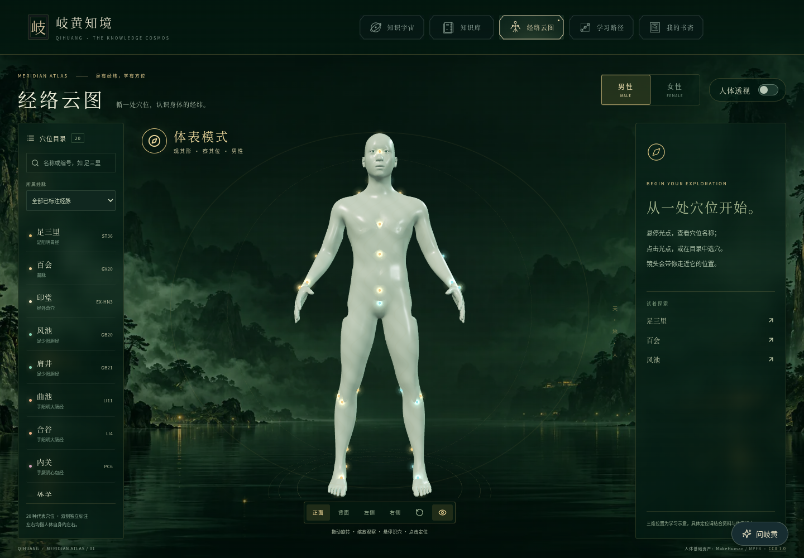
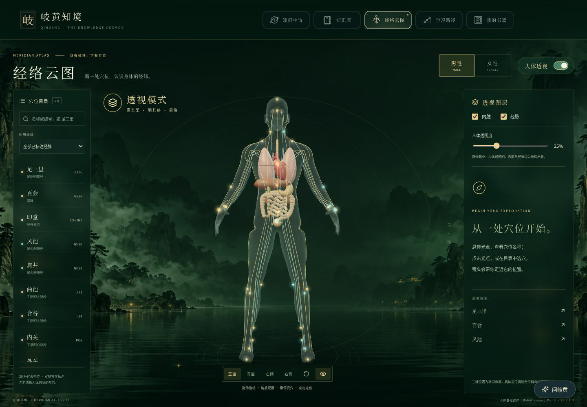
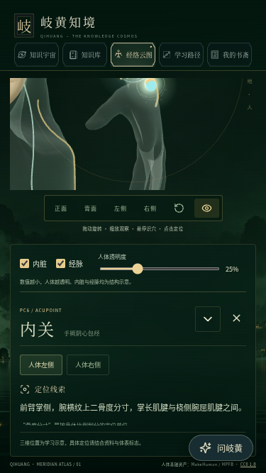

# 经络云图青玉透视版验证

本次基于 `254b872`（包含最新导航修复）继续，范围与设计见 [本次设计](superpowers/specs/2026-10-15-meridian-immersive-design.md)。

## 素材与功能

- 男女两版 v2 人体来自现有 MPFB CC0 基底；使用连续表面，调整肌肉比例与垂臂姿态，保留两版独立点位。
- 20 种穴位、两版各 34 个光点；光晕、光环和粒子纹理在场景内共享。悬停显示名称 / 编号 / 侧别，点击定位和知识阅读沿用原流程。
- 原创墨绿山水湖面背景，源图保留于本次会话的生成图像目录，站内资源为 139 KB WebP。
- 心肺、肝胆、胃肠、肾与相关连接结构由 `scripts/anatomy/build-organs.py` 制作，源文件为 `art/model-sources/viscera-v1.blend`。模型为结构示意，未作为医学精确资产认证。
- 14 条经脉的主要体表关系示意由 `scripts/anatomy/build-paths.py` 投影到实际男女表面；表面射线落空处断开，不跨越身体空隙连接，也不冒充完整内部分支。
- 首次开启内脏层才下载内脏 GLB；失败保留人体与知识面板，重新勾选可独立重试。
- 顶部导航沿用已上线布局，未重新改动其坐标规则。

## 验证记录

| 检查 | 结果 |
| --- | --- |
| `npm test` | **117/117**，14.2 分钟；含全部 12 项经络云图交互与四种宽度的导航布局回归 |
| `npm run test:production` | **10/10**，标准 `dist` 与 Render 兼容包都验证男女模型、穴位定位、透视内脏请求和许可证 |
| `VITE_API_BASE_URL=https://qihuang-api.onrender.com npm run release:build` | TypeScript、构建及两个发布输出通过；保留原有 Three 大分块提示 |
| 经络数据 / 状态 / 相机 Node 测试 | **12/12** |
| Python GLB 验证器测试 | **3/3** |
| 实际模型摘要、预算与观察视线 | 男女人体各 45,112 面、约 1 MB；内脏层 42,000 面、998,084 字节；204 条视线全部通过 |
| 实际浏览器画面 | 1440×1000、390×844、375×667，男女体表 / 透视、选穴与展开阅读；页面报错 0，横向溢出 0 |
| 独立代码审阅 | 发现并修复小屏透视展开时正文区域过小；最终无剩余实质问题 |
| `git diff --check` | 通过 |

小屏问题先用真实浏览器复现：375×667、透视开启且展开知识时，正文只有 16 像素高。修复后实测 112 像素，新增回归还确认可滚动到“完整知识”按钮。全站测试曾为定位此问题主动中断一次；上表为修复后的完整通过结果。

桌面浏览器使用软件 GPU 模拟手机视口，未将其冒充实体手机测试。人体、内脏和线路用于结构学习示意，未做临床定位认证。

## 实际页面

## 发布方式

通过现有 `main` 自动部署链路发布到 Render，不新增服务、环境变量、数据库或费用。实际合并提交与部署状态以本次 PR 和 Render 记录为准。本环境对 Render 站点 HTTP 的访问受代理策略限制，功能验证来自本地正式包，线上部署状态通过 Render 接口确认。
