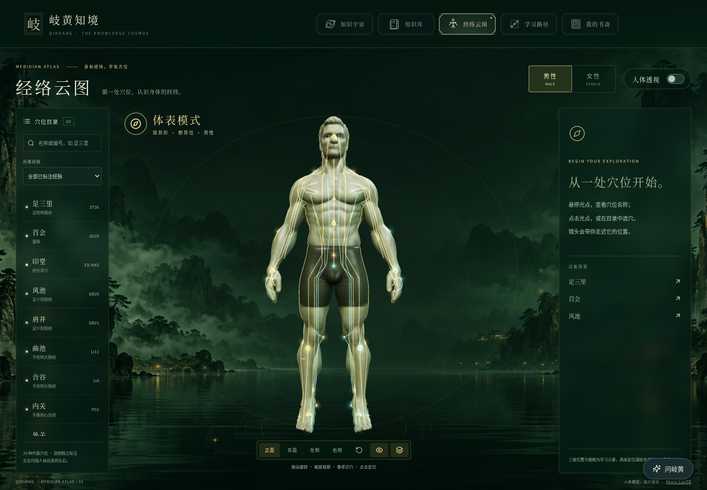
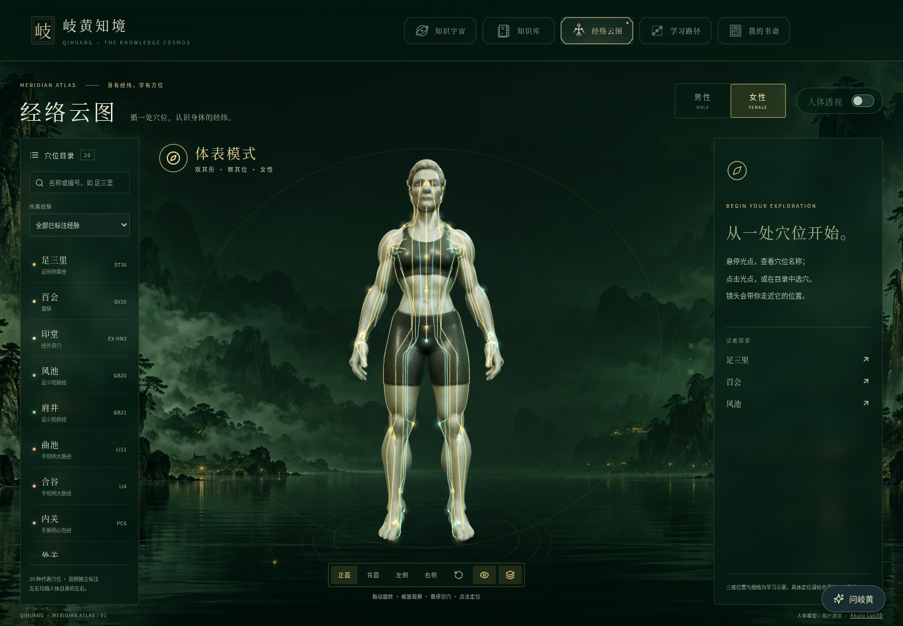
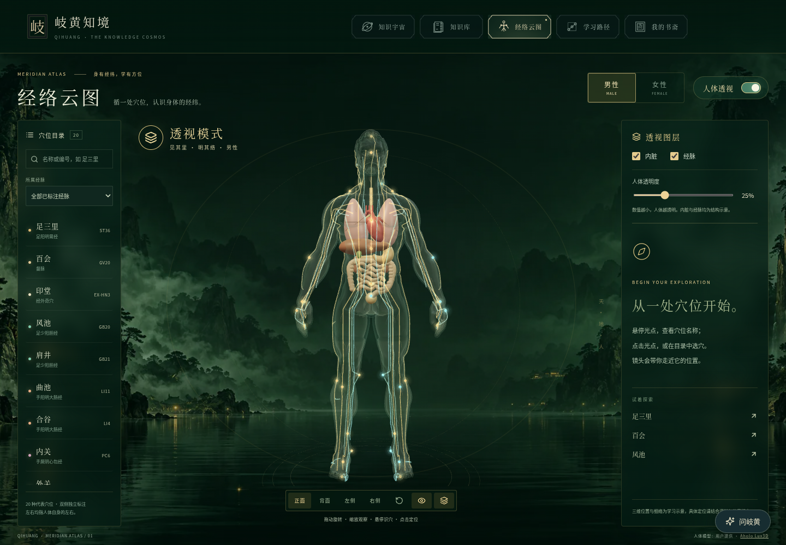
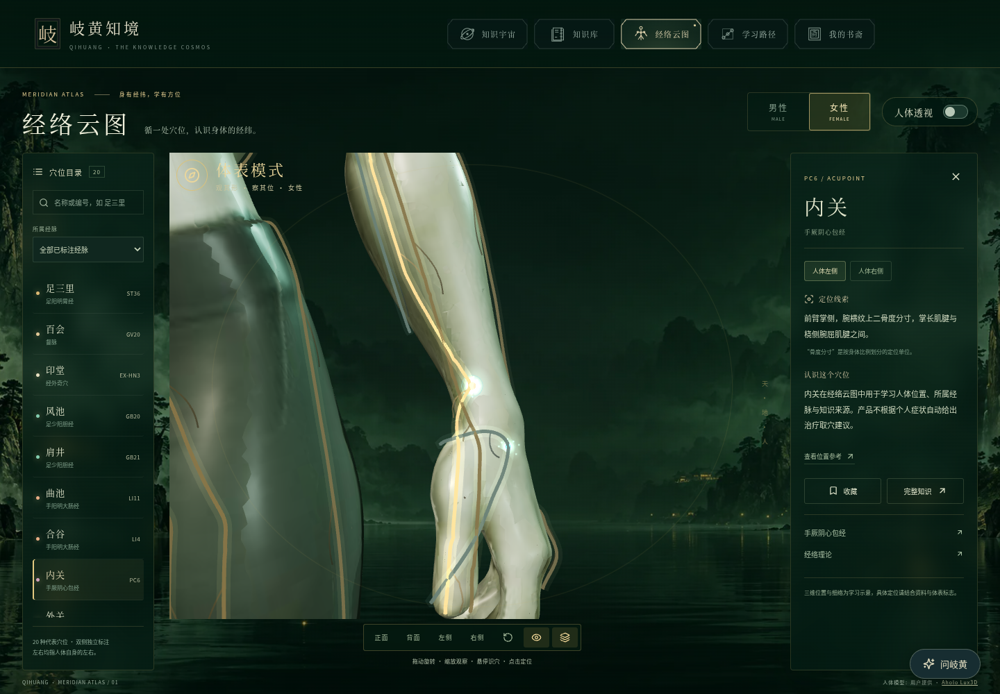

# Lux3D 经络云图验证记录

本次基于 `d7ce433`，保留最新导航布局和移动知识面板修复。设计与实施计划见 `docs/superpowers/specs/2026-10-15-meridian-lux3d-design.md` 和同日计划。

## 完成内容
- 替换为用户上传的男女 Lux3D 人体，保留全部几何：男性 291,276、女性 287,422 三角面。原始 GLB 的占位图替换为各自随包提供的 2048×2048 漫反射图，导出内嵌 JPEG 的独立 GLB（9,474,448 / 9,410,084 字节），没有外部贴图请求或解码器依赖。
- 规范化到 1.78 m / 1.70 m，脚底原点、Y-up、正面 +Z。脚、膝、手腕、手部标志点分别针对新体形估计并检查；男性合谷使用 45 mm 范围内的局部表面搜索（实际约 27 mm）处理非平面手姿，未无限延长射线到其他部位。
- 两版共 68 个穴位锚点重新投影；每个模型的锚点、主要经脉和细络绑定实际导出文件 SHA-256。模型缓存不共享被修改的材质，保留源贴图、UV 和服装颜色。
- 两版各 14 条主要经脉体表关系示意，含分别贴合网格的主线和细络（总 268 / 243 段）；26,460 个采样点距离网格表面 3.5–3.8 mm。所有已标注同经穴位距离相应主线采样点小于 12 mm。
- 合并经脉几何为少量绘制批次，包含主线、淡细络、辉光与缓慢移动光点。体表及透视模式均可显示，选穴突出所属经脉；底部新增独立经脉开关并与透视复选框同步。
- 悬停识穴、点击定位、双侧切换、知识阅读及收藏沿用原流程。近距离光晕随镜头距离缩小，避免覆盖手部细节。透视保留轮廓、独立内脏与经脉开关和透明度状态，男女切换保留选择。
- 新模型如实署名为用户提供的 Aholo 输出；保留历史 MPFB CC0 文本与网站既有许可，不把新模型改标 CC0。

## 验证
| 检查 | 实际结果 |
| --- | --- |
| Python 模型与经脉测试 | 6/6，通过完整面数、内嵌纹理、摘要、路由类别、点位邻近和段间距离检查 |
| Node 数据、相机、状态、材质测试 | 13/13 |
| 最终网格观察视线 | 两版 × 34 点 × 3 宽高比 = 204/204；无被身体遮挡的最终镜头 |
| 开发浏览器回归 | 经络 13 项 + 四种宽度导航共 17 项均已验证。首轮 16 通过；内脏下载重试测试在修改 Vite 许可证复制插件时被开发服务器重启打断，稳定配置后单独重跑通过（14.1 秒） |
| 正式输出回归 | 16/16（`dist` 与 `public` 各 8 项），包括最新移动知识面板修复 |
| 发布构建 | TypeScript、Vite、标准包与兼容包通过；保留 Three/经络数据大分块提示 |
| 实际网页检查 | 1440×1000 男女体表/透视、男性侧背、女性手腕，以及 375×667 移动观察和透视阅读；两轮只读浏览器检查页面异常均为 0 |
| 独立审查 | 新审查上下文检查材质、几何、切换、资源生命周期、图层、来源和打包，无实质发现 |
| `git diff --check` | 通过 |

正式包首轮发现新增来源说明未复制进 `dist`：项目关闭了 Vite 的默认 public 复制；已将说明加入现有构建插件并重跑全部 16 项正式包检查通过。

## 实际画面

## 范围与限制
这是实际三维网页的截图，不是参考概念图。模型保留用户导出物的细节与限制，没有声称达到离线概念图的完全一致效果。主线为主要体表关系示意，细络为视觉表现；没有伪造完整经络内部分支、血管或神经。沿用的独立内脏是结构教学示意，非医学精确重建。
每版约 9.5 MB，仅在进入经络页并选择该版本时下载；内脏首次开启才下载。桌面 Chromium 使用软件图形后端模拟手机视口，不等同实体手机性能认证。
本环境直接连接 Render 网站返回代理 403，未绕过网络限制；线上版本与构建状态以 Render 记录确认。本次通过现有 main 自动部署链路，不新增服务、环境变量、数据库或费用。实际合并 SHA 与部署记录见 PR 及本次聊天报告。
