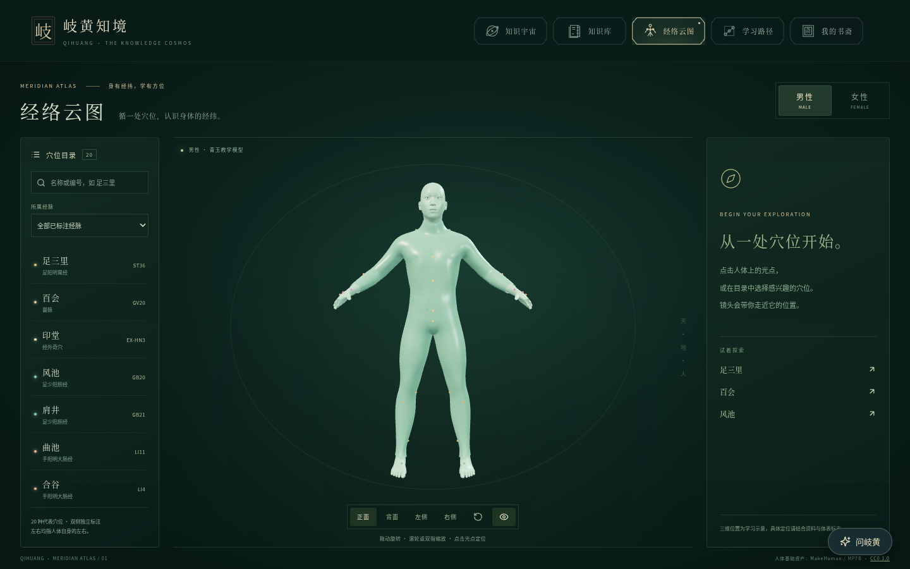
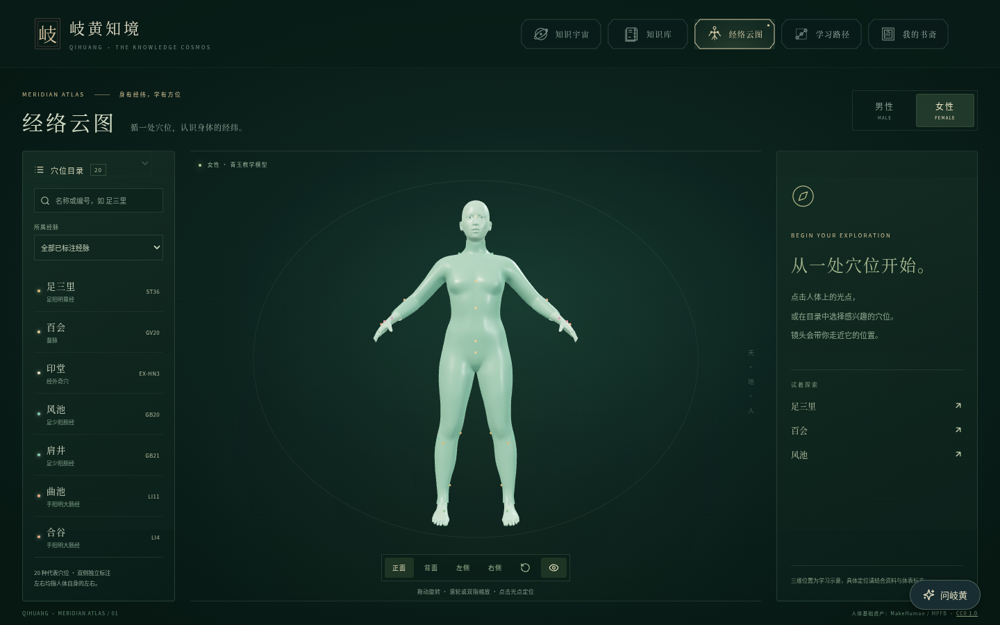
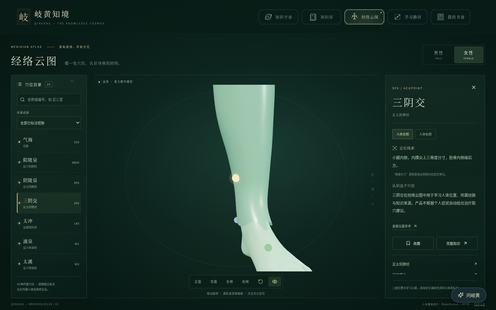
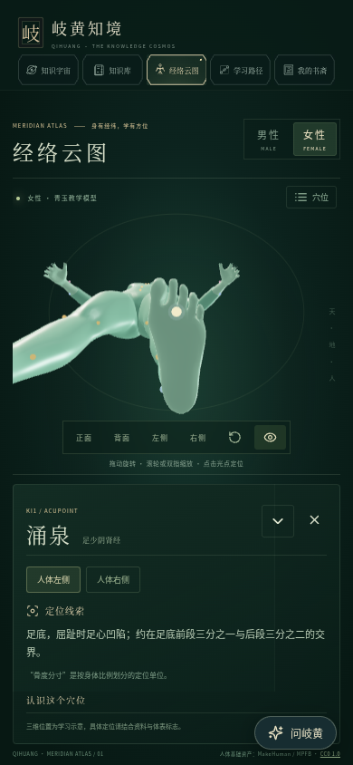

# 经络云图验收记录

2026-10-15（北京时间）。实现分支：`feat/meridian-body`，独立工作目录：`.worktrees/meridian-body`。

## 实际完成范围

新增主导航入口及独立 `#meridians` 页面。成年男女模型分别生成，青玉材质及完整教学服外观；可切换版本，保持当前穴位与人体左右侧。点击光点、列表或搜索结果后按本次飞入起点计时，在约 850ms 内绕行至目标；减少动态设置下直接定位。拖动会取消自动定位。

现有 20 种穴位复用公开知识目录及收藏接口，每版 34 个标记：6 种中线 + 14 种双侧，总计 68 个独立锚点。含经脉筛选、参考编号、定位说明、位置出处、完整知识入口和相关知识。筛选冲突清除原选择并提示；正背侧面观察保留知识选择，回到全景清除选择。

桌面目录 / 人体 / 知识三栏；手机折叠目录与底部可展开面板，Canvas 根据实际剩余区域重新构图。人体页卸载星云，只运行一个人体 Canvas，按需绘制；其他页面保持原有星云和课程入口。

切换加载期间保留原模型，暂停光点点击，接受最新版本选择；旧请求不能覆盖新请求。目标失败保留原人体与知识，提供重试。成功后才保存浏览器偏好。初次加载失败、模型解析失败、WebGL 缺失 / 丢失及三维模块失败均有阅读降级入口；WebGL 丢失可主动重试三维显示。

本版不绘制未经逐段核验的经脉循行线，不添加完整 361 穴库、针刺操作、症状配穴或新 AI 功能。三维点位为学习示意，未经过临床定位认证。

## 资产与来源

| 模型 | GLB 字节 | 三角面 | 实测高度 |
| --- | ---: | ---: | ---: |
| adult-male-v1 | 1,123,292 | 46,949 | 1.7783m |
| adult-female-v1 | 1,142,240 | 47,689 | 1.6977m |

男性 SHA-256：`40398aaf163d937cc66c03aaaaf5494b1be50766acef878a87fdcd16d2e41826`。

女性 SHA-256：`3ab7825618cd733c5b6d63ebde791ce67f7e15bbc495632c71e4ab21d8ad93b6`。

GLB 自包含、米制、Y-up、正面 +Z，无外部纹理、动画或远程解码器。男女各有可编辑 Blender 源文件及正 / 侧 / 背六张真实渲染。来源与许可见 [BODY-MODEL-SOURCE.md](../third-party/BODY-MODEL-SOURCE.md)，完整 CC0 文本已打包至两个发布输出；现有诗云 MIT 和 React Bits 许可保留。

位置资料逐条整理并记录出处，以 KMCRIC 标准位置数据库为主，肩井与膻中分别补充 PMC5817322 和 PLOS ONE 10.1371/journal.pone.0316804。最终表面锚点与对应模型文件哈希绑定，替换模型必须重做标注和检查。

## 实际验证

| 验证 | 结果 |
| --- | --- |
| `python3 scripts/anatomy/verify-assets.py src/assets/anatomy` | 两版尺寸、面数、坐标、预览、哈希与自包含资源检查通过 |
| `python3 -m unittest discover -s scripts/anatomy/tests` | 3/3，通过合法资源与损坏 / 超预算 / 外部资源拒绝检查 |
| `server/node_modules/.bin/tsx --test src/features/meridians/__tests__/*.test.ts` | 12/12，通过模型 / 锚点完整性、切换请求、偏好、筛选、相机与遮挡逻辑检查 |
| `node scripts/anatomy/verify-views.mjs` | 68 点 × 宽高比 1.2 / 0.72 / 0.45，204 条真实网格视线全部通过 |
| `npx playwright test --config playwright.meridians.config.ts` | 最终 9/9，通过真实光点点击、背面遮挡、后颈 / 脚底观察、共享收藏、快速切换、保留旧模型 / Canvas / 成功偏好、网络失败 / 重试、WebGL 恢复、手机布局、视角 / 筛选语义、空闲后飞入计时 |
| `VITE_API_BASE_URL=https://qihuang-api.onrender.com npm run release:build` | TypeScript 和正式构建通过，`dist` / `public` 兼容包及许可证生成完整 |
| `npm run test:production` | 10/10，两个发布输出均通过人体模型、定位、许可证、原有导航 / 学习记录 / 手机聊天检查；普通页面不请求 GLB |
| `npm test` | 初跑 103 项，102 通过；1 项旧导航 `aria-current` 在并发软件 GPU 验证期间超时。单独带 trace 重跑该项通过；未改产品或测试掩盖超时 |
| `TEST_DATABASE_URL=... npm --prefix server test` | 65/65，仅使用本次独立临时 PostgreSQL，未连接线上数据库 |
| `git diff --check` | 通过 |

独立审阅发现并修复：小腿内侧点遮挡、模型切换失败丢失原画面 / 保存失败偏好、角度按钮清空知识、筛选残留冲突点、静止持续渲染、WebGL 缺少恢复入口，以及按需渲染后累计空闲 delta 导致飞入跳帧。最终复查无实质阻塞。

实际正式包截图没有页面异常或横向溢出。已检查桌面 1440×900、手机 390×844 和横屏布局；未做实体手机 GPU / 触控测试，当前手机证据为 Chromium 模拟视口及软件 GPU。

## 实际页面截图

## 交付与线上状态

此前 MIT 来源和许可上线任务保持完成，本次没有重复实施。保留并合入工作基线的远端最新修改 `9b8d4ae`，包括现有书籍课程、卡片插画与几何导航。

经已确认 Render 工作区 `My Workspace` 查询，前端 `qihuang-zhijing` 与 API `qihuang-api` 的当前部署均为 `live`，提交 `9b8d4ae48e44dfede8721510a56993c6ad380af7`。本环境对 Render 网站 HTTP 的访问受代理限制，因此线上判断来自 Render 部署接口，不冒充线上浏览器功能实测。

本次新增功能以实现分支和可审查 PR 交付，尚未合入 `main` 或部署。此前 MIT 修改的上线授权不扩展为本新增页面的发布授权。新页面的实际访问路由为 `/#meridians`；上面的功能与截图均来自本地正式构建。
