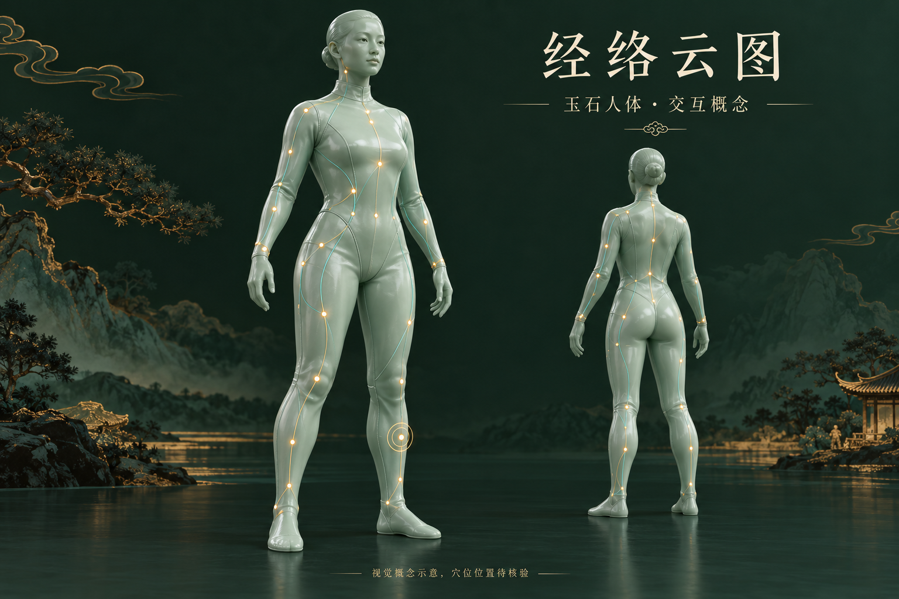
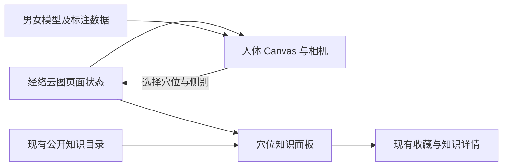

# 岐黄知境 · 经络云图设计方案

日期：2026-10-15（北京时间）

状态：设计稿，供用户审阅；尚未进入功能实现与发布阶段。

## 1. 目标与已确认方向

新增独立的「经络云图」网页，让中医学习者在三维人体上探索穴位。
点击穴位后，镜头转向并靠近对应部位，保持观察视角，旁边展示该穴位的知识。
成功标准是：模型形态符合已确认风格，穴位可以找到、选中和看清，知识与现有
知识库对应，切换人体版本不会打断当前学习。

用户已确认：

- 使用青玉质感的人体模型，延续网站的墨绿、青玉与暖金色视觉。
- 提供男性、女性两套人体，由用户自行切换。
- 人体上显示穴位，点击后的镜头定位类似现有星云的点击放大体验。
- 侧边展示当前穴位知识。

本方案建议首版先使用现有 20 种穴位，采用下述模型来源和交互细节；这些具体
范围与默认行为属于本次待审阅的设计建议。

图片只定义材质、光点和整体风格，不是实际三维模型，也不是穴位定位依据。
男女模型均采用完整覆盖的教学服外观，减少服装接缝与装饰，不遮住学习所需的
人体结构轮廓。场景背景采用安静的墨绿色，不复刻概念图中的山水布景。

## 2. 当前项目基础

在本地版本 `a002c94` 核对到：

- React、Three.js、React Three Fiber、Drei 和 Zustand 已存在。
- `UniverseScene.tsx` 已有相机平滑靠近目标与手动观察的实现思路。
- `src/data/knowledge.json` 有 20 条腧穴条目和 14 条经脉条目。
- `useKnowledge` 维护现有公开知识目录，收藏与知识详情已有成熟入口。
- 当前没有人体 GLB 模型、男女模型配置或穴位三维坐标。
- 多数穴位内容仍是概括性简介，不能把条目存在视为定位资料已经齐全。
- 当前所有页面都包在 `Universe` 中，默认持续挂载星云 Canvas。
- 本环境可调用 Blender；人体基底与相应工具资产仍需在模型制作阶段获取和核验。

## 3. 模型路线选择

| 路线 | 优点 | 代价与限制 | 建议 |
| --- | --- | --- | --- |
| MakeHuman / MPFB 官方基底 + Blender 加工 | 男女模型可采用一致姿态和制作流程；可调整形态与青玉材质；官方核心资源及导出模型有清楚的授权说明 | 仍需手工修整、资产逐项核验、点位标注；基底不是医学定位认证 | 首选 |
| 获取许可明确的现成人体 GLB | 可较快开始网页交互 | 男女模型可能姿态、比例或拓扑不一致；社区模型许可各异；可能需要较多清理 | 可作为替代资产路线 |
| 完全自行雕刻人体 | 形态控制最完整 | 工作量最高；结构准确性、手足细节和后续维护都需额外投入 | 首版不采用 |

推荐使用 MakeHuman / MPFB 官方核心资源建立成年男性和成年女性基底，再在
Blender 中处理教学服外观、固定姿态和青玉材质。官方 FAQ 说明 MakeHuman
导出模型可按 CC0 使用；社区服装、头发等附加资源仍逐项检查，优先采用
官方核心资源或自行制作的附加形态，不把所有社区素材默认为 CC0。

模型制作交付物：男女各一份可编辑源文件、一份网页用 GLB、一套正面与背面
静态预览，以及资产来源清单。记录工具版本、基底版本、作者、授权文件、
下载来源和本项目修改范围；模型许可与诗云 MIT 代码许可分别记录。

## 4. 模型形态与技术约束

- 采用成年教学人体比例；男女版本分别制作，不通过简单缩放同一模型代替。
- 两版均保持站立、手臂稍离躯干、双脚稍分开的固定教学姿态。
- 手指、脚部、关节和面部能辨认；不采用机器人、积木拼接或粒子轮廓替代。
- 青玉材质保持温润、适度粗糙；避免镜面反射吞没穴位光点和身体轮廓。
- 两版统一世界坐标约定：米制、Y 向上、人体正面朝 +Z；左右按人体自身定义。
- Blender 导出时应用变换并冻结教学姿态；首版不增加身体动画。
- 标注坐标绑定最终 GLB 的版本或内容哈希；替换姿态、比例或网格后重新核验。
- 网页加载模型后只作一致的显示变换，模型、穴位和经脉必须在同一父坐标系中。
- 设计预算为每版 GLB 不超过 4 MB、主体不超过约 5 万三角面；使用简洁材质，
  不引入高分辨率皮肤贴图和额外远程解码服务。预算需在模型验收时实测。

模型形态先交付男女各一组正面、侧面、背面预览。用户验收后再开始穴位标注，
避免先标注再大幅修改模型结构。

## 5. 页面布局

主导航新增「经络云图」，首版路由为 `#meridians`。
保留现有品牌、页面切换、学习记录与账号入口，人体页使用独立的场景和工具。

### 电脑端

- 顶部：标题、男性 / 女性切换、穴位搜索。
- 左侧：穴位列表与所属经脉筛选，可展开或收起。
- 中央：人体与穴位光点，是主要视觉区域。
- 右侧：知识面板；未选中时显示简短操作说明，选中后显示对应穴位。
- 场景工具：正面、背面、左右侧面、回到全身、显示 / 隐藏经脉示意线。

### 手机端

- 顶部保留模型切换和搜索，次要筛选折叠收纳。
- 人体保持可操作区域；选中穴位后底部出现可展开的知识面板。
- 面板以明确的收起 / 展开按钮控制，不要求用户必须学习拖拽手势。
- 镜头按面板未遮挡的实际区域重新构图，避免穴位被面板盖住。
- 一个手指拖动旋转，双指缩放；列表和搜索始终可用。

## 6. 交互规则

### 首次进入

首次默认男性模型；之后恢复上次成功加载的模型版本。偏好只存当前浏览器，
不要求登录；浏览器存储不可用时继续正常使用。初始为全身视角，无选中穴位，
人体不自动旋转。

### 点击或搜索穴位

1. 点击光点，或从搜索 / 列表选择穴位。
2. 立即更新名称与知识面板，再平滑转到该穴位预设的外侧观察方向。
3. 在约 0.7–1 秒内靠近目标，选中穴位显示暖金色环；其他光点降低强调程度。
4. 镜头停留后仍可拖动观察；用户开始拖动时立即取消自动镜头移动。
5. 连续点击多个穴位时，后一次选择取代前一次镜头运动。
6. 「回到全身」清除选中状态并恢复全身视角；正背侧面按钮保留当前选择。

每个模型的每个穴位保存观察方向与合适距离，不使用全局统一方向硬套所有
穴位。镜头沿人体外侧绕行，避免穿过躯干。脚底、手掌内侧和后颈的点位使用
专门的可见视角。用户启用减少动态效果时改为直接定位。

### 男女模型切换

- 两个明确的按钮显示当前版本，不依赖颜色或人体外观辨认。
- 切换时保留选中穴位、左右侧、搜索文本和经脉筛选。
- 目标模型加载完成后，按新模型的坐标和观察方向重新构图。
- 加载期间保留当前模型和面板，提示目标版本正在加载；人体点选暂时停用，
  模型切换按钮仍可响应，以最后一次选择为准，较早完成的加载不得覆盖新选择。
- 加载失败时保持原模型可用，并提供重试；只在切换成功后保存版本偏好。
- 对没有该侧标注的条目，不猜测坐标；保留知识阅读并显示三维定位暂不可用。

### 点位、左右与遮挡

- 同一穴位知识只保存一份；双侧穴位有独立的左右标记和坐标。
- 中线穴位只渲染一次，不机械生成左右两个点。
- 当前范围是 20 种穴位，不是限定为 20 个光点；双侧标记会增加实际光点数。
- 左右名称以人体自身为准，列表和面板同步注明。
- 背向或被人体遮住的点不透视点击；从列表选择仍可将镜头转到可见位置。
- 默认不显示全部穴位名称；只显示悬停 / 选中名称及必要的引导。
- 小光点使用更大的命中区域，但必须通过人体遮挡判断，避免点击到背面穴位。
- 筛选与已选穴位冲突时，清除选择并提示用户；不保留一个不可见的选中点。

## 7. 穴位与经脉内容

首版目标范围为现有 20 种：足三里、百会、印堂、风池、肩井、曲池、合谷、
内关、外关、神门、膻中、中脘、关元、气海、阳陵泉、阴陵泉、三阴交、太冲、
涌泉、太溪。逐点完成名称 / 编号、归属、定位说明、资料来源和男女坐标核验，
并区分中线与双侧点位。

### 内容来源与知识面板

名称、简介、正文、出处和关联知识从现有公开知识目录按 `knowledgeId` 读取，
不在人体页复制另一份知识库。面板提供收藏与进入现有完整知识详情的入口。
收藏仍沿用现有游客 / 账号同步规则；本功能不新增一套账户和学习数据库。

定位学习说明、参考编号、左右属性和核验记录归入专门的空间标注数据。
参考 WHO 标准与明确版本的经络腧穴教材，记录具体条目和资料版本；奇穴需
使用覆盖其内容的单独来源，不把所有穴位都写成由同一本标准覆盖。

首版定位信息由资料整理与模型标注流程维护，不新增后台坐标编辑器。
已有后台仍可修改知识正文。知识条目未发布或不再出现在公开目录时，其光点
和列表项停止展示；当前选择随之清除。网络同步失败时沿用现有已载入目录。

三维模型用于空间学习，不能把示意坐标写成适用于所有个体的临床精确定位。
点位缺少核验时不作为已核验定位发布。第一版不加入针刺操作、个体治疗推荐
或根据症状自动配穴。

### 经脉显示范围

筛选依据穴位与现有经脉条目的关联关系。当前目标穴位不能覆盖全部 14 条
经脉；列表只提供当前已标注点位对应的经脉，以及奇穴分类。

经脉体表示意线采用单独整理并核验的路径数据，不用稀疏穴位之间的直线
冒充完整经脉走行。首版仅展示完成路径标注的经脉；其余穴位仍正常展示所属
经脉文字与知识链接。界面清楚标明当前为常用穴位与已整理体表线路示意。
完整经络系统、内脏分布和所有经典穴位属于后续扩展范围。

## 8. 数据与模块边界

空间数据的最小结构：

- `BodyModel`：模型版本、GLB 路径、预览图、模型哈希、坐标约定、来源记录。
- `AcupointDefinition`：现有知识 ID、核验后的参考编号、所属经脉、侧别规则、
  定位学习说明、出处与核验记录。
- `AcupointAnchor`：穴位 ID、模型版本、侧别、表面坐标、向外法线、观察方向、
  观察距离、对应模型哈希和核验记录。
- `MeridianPath`：经脉 ID、模型版本、侧别、核验后的体表路径与来源。
- 页面状态：已显示模型、正在请求的模型、选中穴位及侧别、筛选、搜索、
  面板展开状态、模型加载错误。

建议模块职责：

| 模块 | 职责 |
| --- | --- |
| `MeridianPage` | 页面布局、搜索筛选、模型切换和选择状态 |
| `BodyCanvas` / `BodyScene` | 3D 生命周期、模型载入、场景灯光与材质 |
| `AcupointLayer` | 光点、命中、遮挡与选中光圈 |
| `MeridianLayer` | 读取已核验线路，显示经脉示意与选中强调 |
| `BodyCameraRig` | 全身 / 侧面视角、穴位飞入、手动打断与面板构图 |
| `AcupointPanel` | 读取现有知识、展示定位资料、收藏与详情跳转 |
| 模型及标注注册表 | 校验模型版本、左右规则、坐标与知识 ID 的对应关系 |

这些模块放在独立的 `features/meridians` 目录；不把人体坐标塞进星云的
`knowledgeSpace.ts`，也不直接改写星云相机来兼任人体相机。

## 9. 加载、性能与失败处理

- 人体页代码与 GLB 按需加载，不进入人体页时不下载男女模型。
- 当前版本优先加载；另一版本在用户选择时加载，成功后在当前会话缓存。
- 男女版本只有当前模型挂载到场景；保留可复用资产缓存，但不同时渲染两个人体。
- 进入人体页时卸载星云 Canvas；离开后卸载人体场景，释放场景独占的渲染资源，
  并恢复正常星云页面。共享模型缓存由加载层管理，不在离开时销毁仍待复用的
  共享几何体与材质；移除缓存时统一回收。
  现有星云、知识库、学习路径与书斋之间保持原有 Canvas 复用行为。
- 共用页面外壳，人体页隐藏星云专用搜索、画质设置、粒子统计与操作提示，
  换为人体页自己的搜索、视角工具和加载状态，避免出现两套同义控件。
- 首版人体材质不依赖 Bloom 和多层后处理；手机 DPR 上限 1.5。
- 用户停止操作、镜头动画结束后采用按需绘制；页面不可见时暂停动画。
- 模型失败、WebGL 不支持或上下文丢失时，保留穴位列表与知识面板，并展示
  对应版本静态预览和重试入口；静态预览不会假装支持三维飞入。
- GLB、静态图、许可和标注数据从本站构建资源提供，避免运行时依赖外部模型站。

## 10. 首版边界与验收

首版包含：一个独立页面、男女两版模型、20 种目标穴位、独立坐标与视角、
搜索 / 列表 / 经脉筛选、穴位点击飞入、知识面板、左右切换、模型偏好、
正背侧面 / 回全身、已有收藏和详情入口，以及静态降级。

首版不包含：完整 361 穴数据库、内脏 / 骨骼 / 肌肉拆层、身体动画、自动治疗
配穴、针刺模拟、用户自定义人体比例、在线坐标编辑器或找穴位考试。
现有 AI 助手保持现状；人体页专属 AI 功能和学习测验作为后续扩展讨论。

验收重点：

1. 男女模型的正面、侧面和背面都符合青玉教学风格，手足结构清晰。
2. 每个目标穴位有对应的公开知识 ID、左右规则、来源和两版模型上的核验记录。
3. 前侧、后侧、手部与脚底的代表点可以选中，镜头能把目标移到可见区域。
4. 切换男女保留穴位和侧别；加载失败、快速反复切换不产生错位或旧请求覆盖。
5. 旋转时人体后方点不可误选；搜索 / 列表可访问被遮挡的点。
6. 手机面板不挡选中点，没有横向溢出；所有主要操作也能通过按钮或列表完成。
7. 已发布知识、收藏和完整详情保持一致；人体与星云不会同时持续渲染。
8. 标准 `dist` 与兼容发布路径均能加载模型、预览图和对应许可；原有页面回归通过。
9. 不支持 WebGL 和模型下载失败时仍能阅读知识，不出现空白页。

验证采用数据完整性检查、相机与坐标逻辑测试、浏览器交互测试，以及男女
模型多角度截图复核。点位资料核验与视觉准确性检查不能由自动化测试替代；
手机体验需真机检查，桌面浏览器模拟手机视口只作为布局回归。

## 11. 建议交付顺序

1. 审阅本方案，确认首版范围与模型制作路线。
2. 制作两版基础人体，提交正 / 侧 / 背面预览，确认形态后冻结模型版本。
3. 整理目标穴位定位资料，并在冻结模型上完成两版独立标注与可见观察视角。
4. 实现独立页面、男女切换、选穴位飞入和知识面板。
5. 完成筛选、收藏、资源加载、失败降级与手机布局。
6. 完成验收和适当回归，再依据当时的发布授权合并最新代码并部署。

当前方案已具体到模块与验收条件，但实际人体资产、坐标和线路仍需按照上述
步骤制作与核验；本设计稿不宣称这些素材已存在或功能已完成。

## 12. 参考与许可依据

- [MakeHuman 官方：导出模型与 CC0 说明](https://static.makehumancommunity.org/oldsite/faq/can_i_sell_models_created_with_makehuman.html)
- [MakeHuman 上游许可](https://github.com/makehumancommunity/makehuman/blob/master/LICENSE.md)
- [WHO：WHO standard acupuncture point locations in the Western Pacific Region](https://iris.who.int/handle/10665/353407)
- [WHO：Standard acupuncture nomenclature](https://www.who.int/publications/i/item/9290611057)

实施时为选定资产和资料固定具体版本，并保留授权与来源记录。资料的事实
核对不等于获得复制整本教材或图片的许可，页面说明采用本项目整理的表述。
